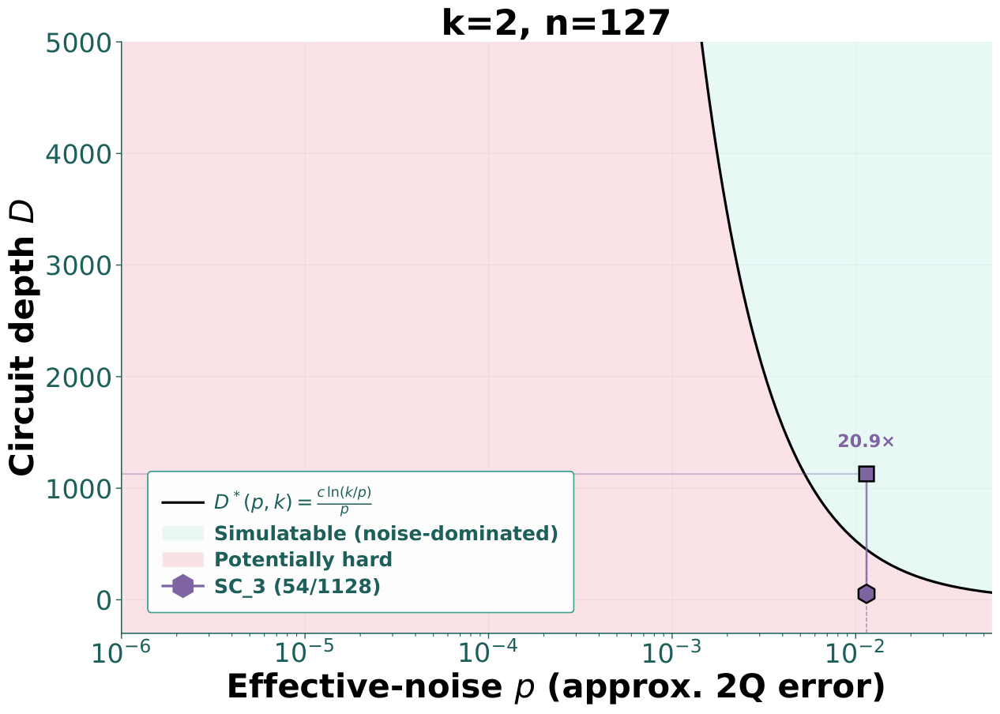

# Noisy IQP paper experiments

Code, saved results and figures for **The Impact of Qubit Connectivity on
Quantum Advantage in Noisy IQP Circuits**, by Leonardo Placidi, Enrico Rinaldi,
Keisuke Fujii and Chen-Yu Liu.

**[Read the paper on arXiv:2604.12635](https://arxiv.org/abs/2604.12635).**
The paper was accepted as a **Technical Paper at IEEE QCE2026**
(IEEE International Conference on Quantum Computing and Engineering), as noted
on its arXiv page.

The experiments compare how different qubit connections change circuit depth
and the effect of noise. Everything runs locally: you do not need access to a
quantum computer or a hardware account.

## Install

Use **Python 3.10**; the tested version is 3.10.20. Open a terminal in this
repository and run:

```bash
python3.10 -m venv .venv
source .venv/bin/activate
python -m pip install --require-hashes -r requirements.lock
python -m pip install --no-deps -e .
export MPLBACKEND=Agg
python -m pytest
```

The lock file fixes package versions to the tested environment, including
Qiskit 2.3.1, pytket 2.15.0 and pytket-qiskit 0.77.0. `MPLBACKEND=Agg` lets
plots be saved without opening a window. The test suite has 44 passing tests.

## Try a small run

This example compiles one six-qubit circuit for each of the dense, local and
sparse patterns on two connectivity models. It saves six result rows in a CSV:

```bash
python scripts/run_swap_benchmark.py \
  --n-qubits 6 --patterns dense local sparse --circuits-per-pattern 1 \
  --hardware fully_connected_6 ibm_washington_6 --seed 42 \
  --logical-circuit-backend qiskit --placement default \
  --output reproduced/example/results.csv
```

This is a quick setup check. The paper's full runs use more circuits and sizes;
their commands are in [REPRODUCING.md](REPRODUCING.md#fresh-compilation-experiments).

## Redraw the paper plots

**[See the generated figures and image previews](reproduced/reference/README.md)**
before running anything. The release includes 23 regenerated plots, including
the larger RHG phase diagram.



The original paper plots are in [paper_images/](paper_images/README.md).
For example, this command redraws the three standard scaling panels from the
saved results:

```bash
python scripts/generate_compilation_overhead_plots.py \
  --input paper_images/compilation_overhead/results_default.csv \
  --output-dir reproduced/scaling --metric depth_ratio_native_fc \
  --extrapolation-fit-points 10 --extrapolation-model exponential \
  --extra-extrapolation-model power_law --extrapolate-to 70 \
  --rename --no-title --legend-size 24 --legend-columns 2 \
  --legend-columns-override local=3 \
  --legend-anchor-y 0.84 --legend-anchor-patterns dense sparse
```

Your new files go under `reproduced/`, alongside the included `reference/`
examples. Git tracks the examples and ignores your local outputs. Each results
folder has a README explaining its files and any differences a rerun can produce.
[REPRODUCING.md](REPRODUCING.md) has the full commands for scaling, phase,
percolation and topology figures.

## What matches the paper?

All **23 paper PDFs and seven result CSVs** are included unchanged. The 22
code-generated panels reproduce the paper images when drawn from the saved
results. The remaining PDF is a separately drawn circuit schematic.
The release also includes the [127-qubit RHG phase plot](paper_images/phase_diagram_qce/phase_diagram_rhg_k2_n127_layers1_samples20_mean_standard_rerun_linear_anon.pdf),
drawn from the saved data for the larger RHG result discussed in the paper.
There are 24 PDFs in total.

A fresh compilation can produce different results because pytket's placement
search has a time limit. In the full rerun, all 5,100 baseline measurements
matched and 4,854 of 5,100 routed depths matched. Five reported mean depths
changed at the paper's rounding precision. These are real compilation
differences, not just PDF formatting differences. See the folder READMEs and
[validation report](results/validation.json) for details.

Keep the seed settings in the full-run guide: standard scaling starts with
seed 42, then applies the SC_3 correction with seed 1234. The phase study uses
seed 42. SC_3's sparse samples therefore differ from those of the other
targets. The paper compares each circuit with its own native-gate baseline.

## Files and dependencies

| Folder | What is inside |
| --- | --- |
| `src/iqp_swap_benchmark/` | Circuit generation, connectivity models, compilation and plotting |
| `scripts/` | Commands that run the experiments and draw the figures |
| [paper_images/](paper_images/README.md) | The paper's figures and saved circuit results |
| [reproduced/reference/](reproduced/reference/README.md) | Generated PDFs and image previews to show the expected outputs |
| [results/](results/README.md) | File checksums, settings and validation results |
| `tests/` | Checks for paper values, saved files and the compilation pipeline |

The experiments use Qiskit to build circuits and pytket to compile them.
NumPy, pandas, SciPy, NetworkX and Matplotlib support analysis and plotting.
Package versions are pinned in `requirements.lock`.

## License

This repository is licensed under [Apache 2.0](LICENSE); see [NOTICE](NOTICE).
