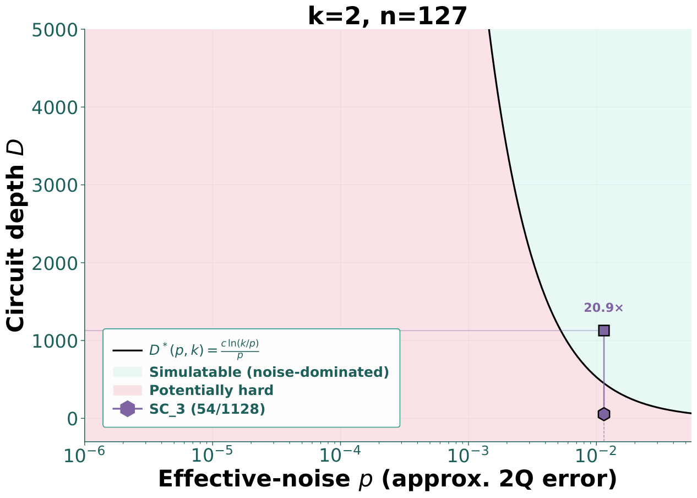

# Expected plot outputs

These are outputs of the supplied plotting code, with PNG previews for browsing
on GitHub and the original generated PDFs for download.

| Gallery | Outputs |
| --- | --- |
| [Scaling](scaling/README.md) | Dense, sparse, local and RHG |
| [Phase diagrams](phase/README.md) | Dense, sparse, local, RHG-90 and RHG-127 |
| [Percolation](percolation/pattern_summaries/README.md) | Four pattern summaries |
| [Connectivity](topologies/README.md) | Ten topology diagrams |

Scaling and phase figures use the archived circuit results. Percolation and
topology figures come from their existing generators. All 23 generated PDFs
match their reference images at 72 dpi. The reference set contains 22 submitted
panels plus the accompanying RHG-127 panel. PDF timestamps can differ.

A fresh circuit compilation can change some measurements because the compiler
uses a time-limited placement search. Each gallery links to the relevant notes;
these examples do not imply that every fresh compilation gives identical depths.

[Reproduction commands](../../REPRODUCING.md) ·
[File checksums and comparisons](../../results/reproduced_artifacts.json)

## Example: larger RHG phase diagram

[Download PDF](phase/rhg_127.pdf)

