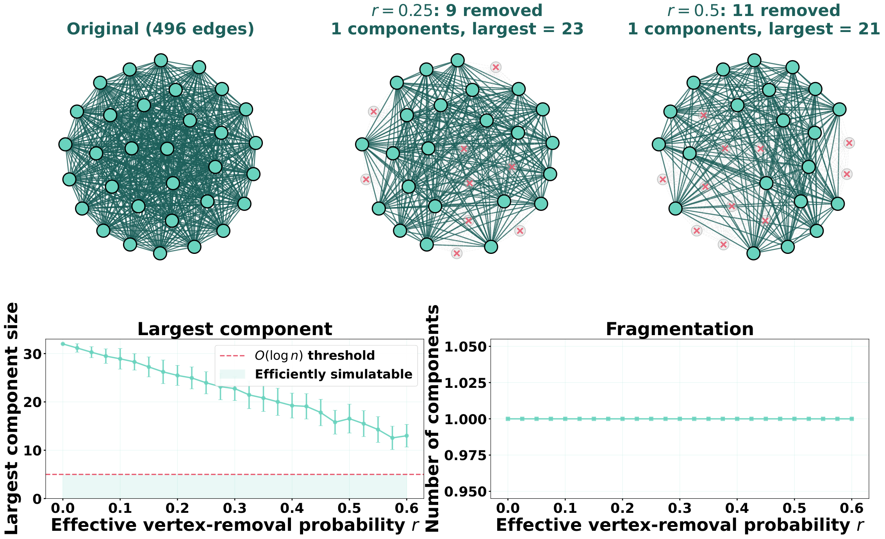
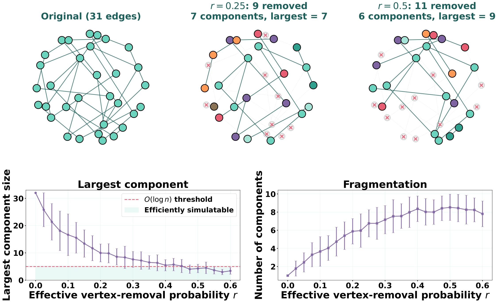
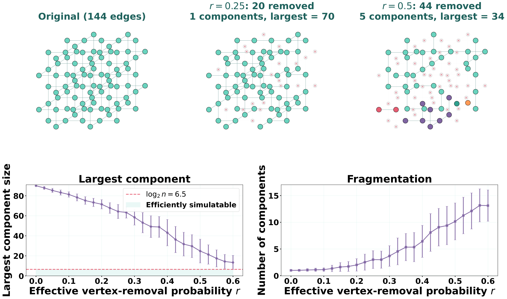
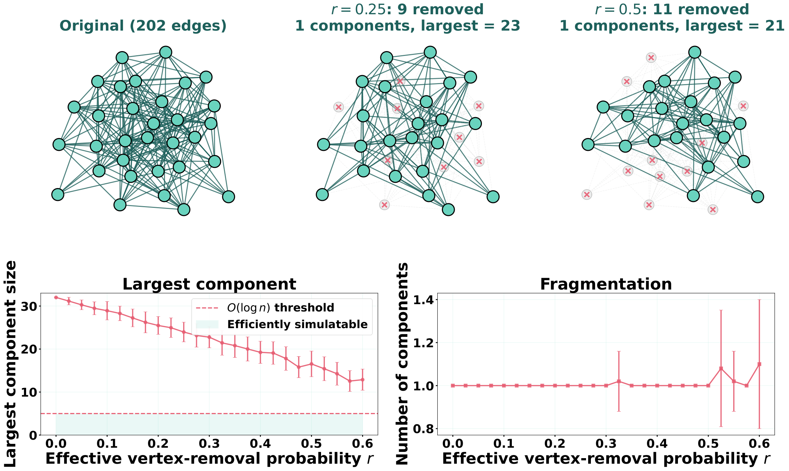

# Percolation

Generated with the fixed seeds in the existing percolation scripts. All four panels match the paper at 72 dpi. Dense, sparse and local use 32 qubits; RHG uses 90.

[Run instructions](../../../../REPRODUCING.md#percolation-and-topology-panels). PNGs below are previews of the downloadable PDFs.

## dense

[Download PDF](dense.pdf)

## local

[Download PDF](local.pdf)

## rhg

[Download PDF](rhg.pdf)

## sparse

[Download PDF](sparse.pdf)

