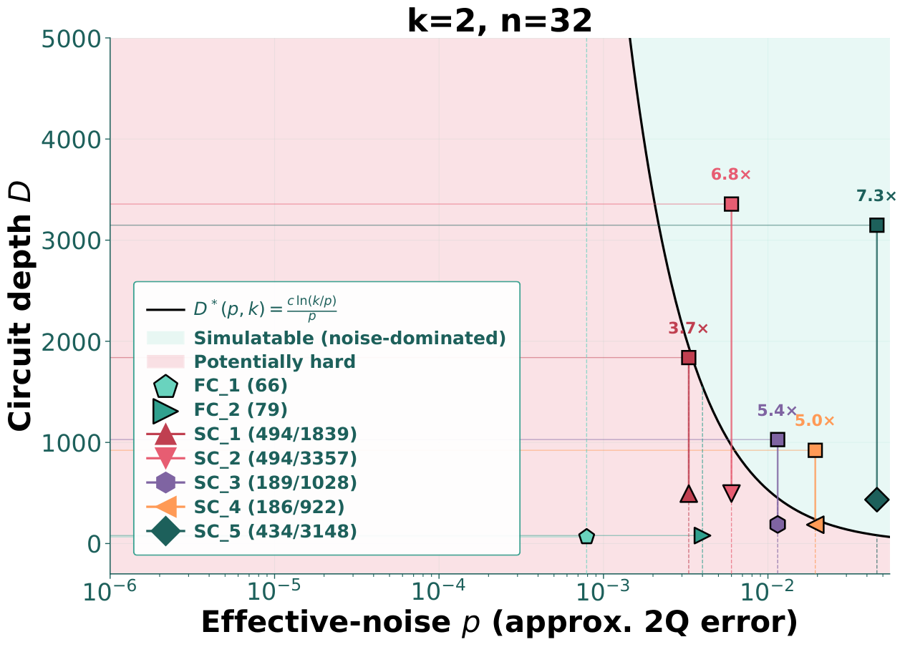
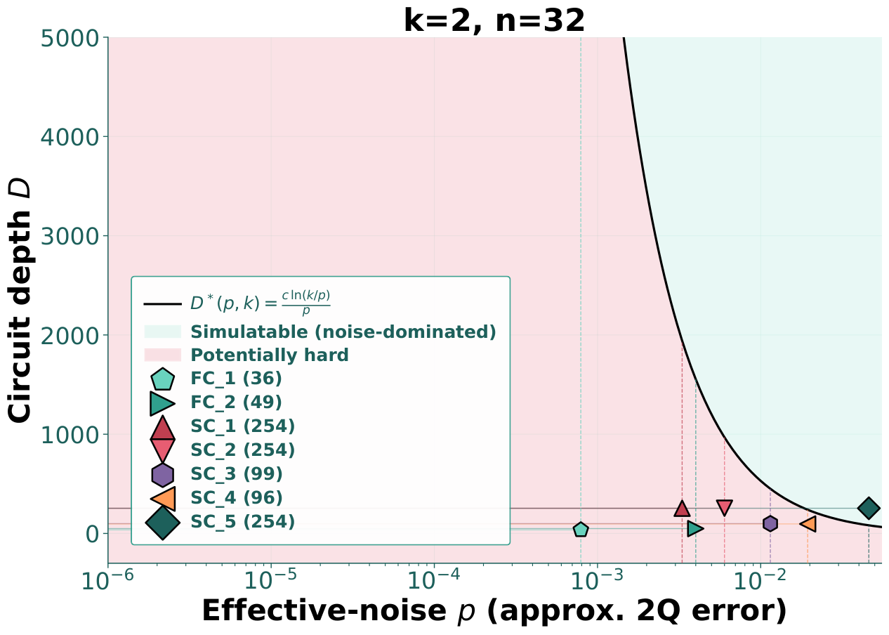
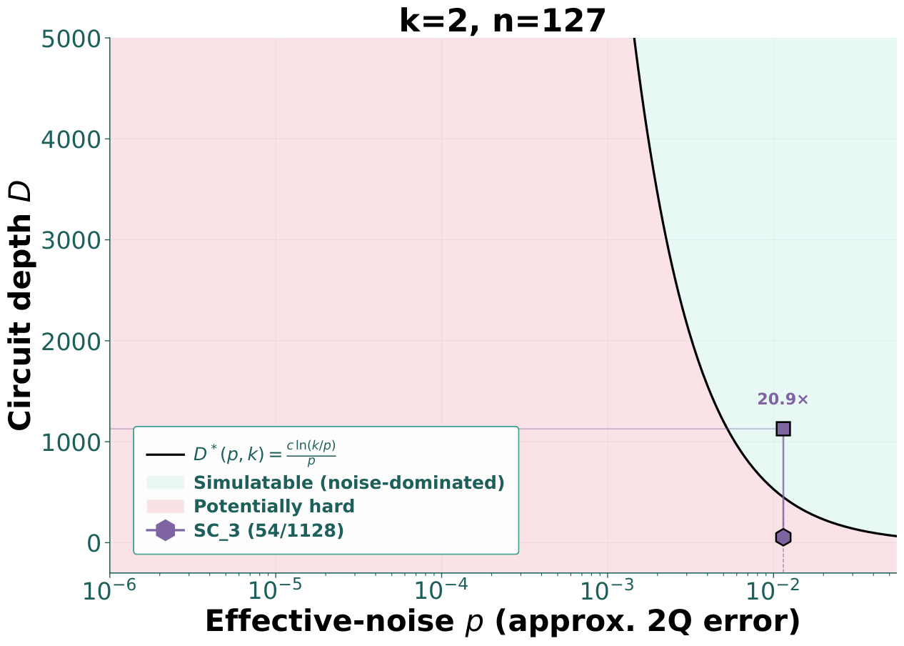
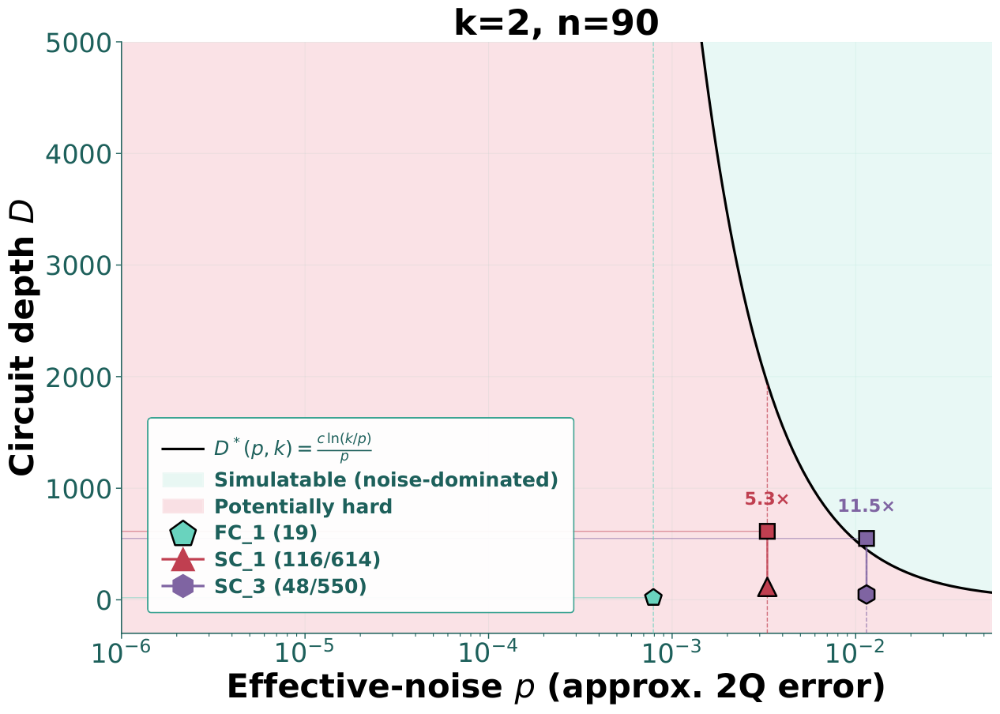
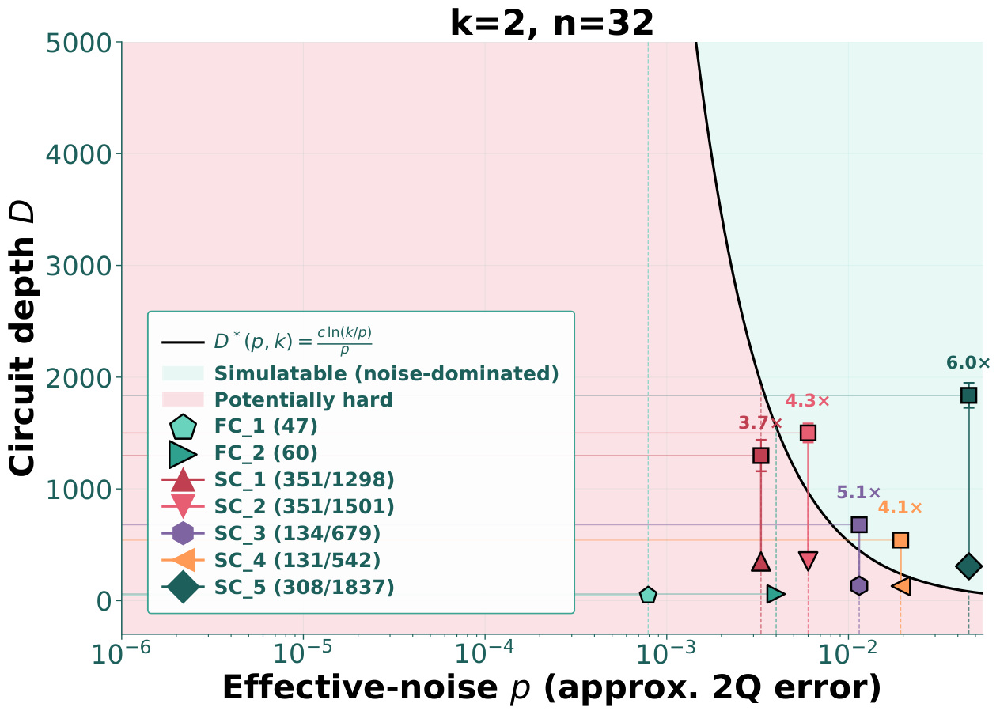

# Phase diagrams

Drawn from the five saved phase CSVs, including RHG at 90 and 127 qubits. All five match the reference PDFs at 72 dpi. RHG-127 is an accompanying plot of the numerical result discussed in the paper. Fresh compilation differences are listed in the [phase notes](../../../paper_images/phase_diagram/README.md).

[Run instructions](../../../REPRODUCING.md#phase-panels-from-saved-circuit-results). PNGs below are previews of the downloadable PDFs.

## dense 32

[Download PDF](dense_32.pdf)

## local 32

[Download PDF](local_32.pdf)

## rhg 127

[Download PDF](rhg_127.pdf)

## rhg 90

[Download PDF](rhg_90.pdf)

## sparse 32

[Download PDF](sparse_32.pdf)

