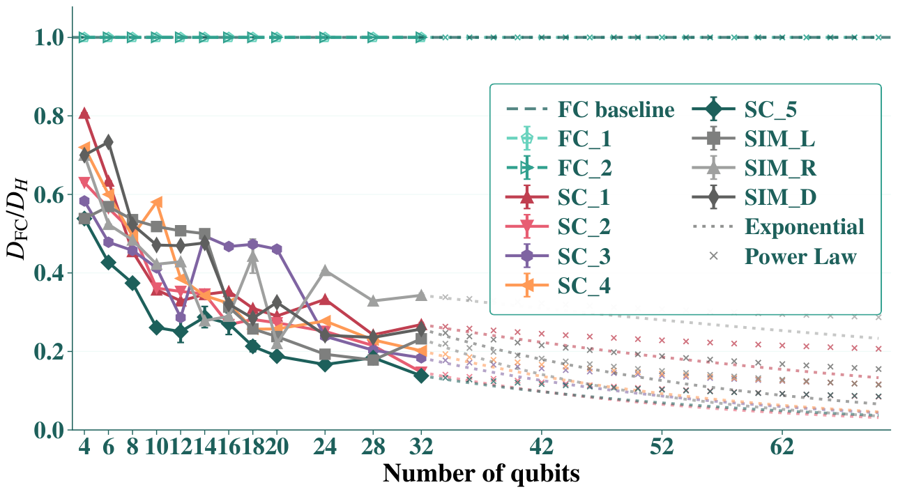
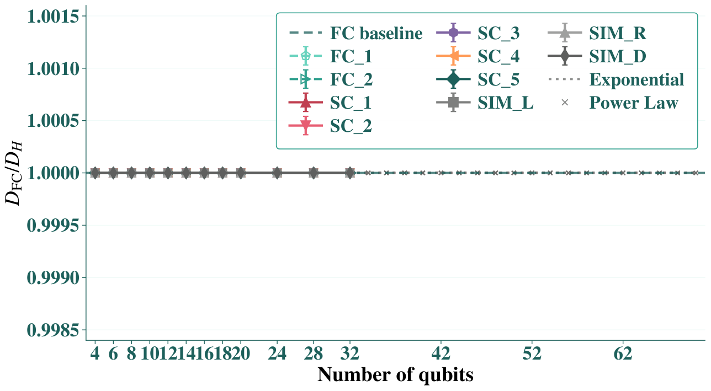
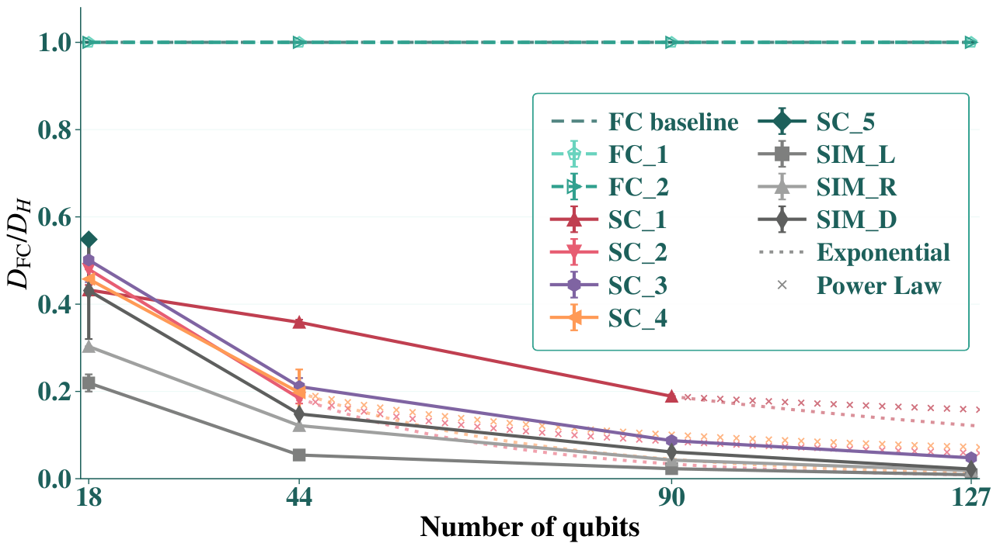
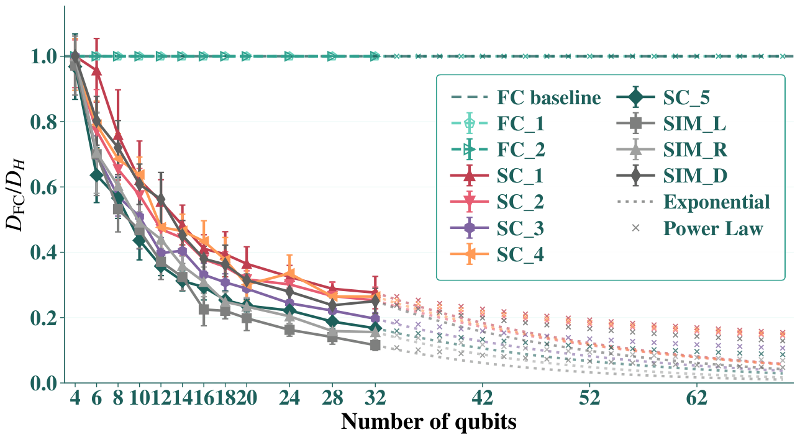

# Scaling

Drawn from the two saved scaling CSVs. All four panels match the paper at 72 dpi. Fresh compilation may change some points; see the [scaling notes](../../../paper_images/compilation_overhead/README.md).

[Run instructions](../../../REPRODUCING.md#scaling-panels-from-saved-circuit-results). PNGs below are previews of the downloadable PDFs.

## ratio vs qubits dense

[Download PDF](ratio_vs_qubits_dense.pdf)

## ratio vs qubits local

[Download PDF](ratio_vs_qubits_local.pdf)

## ratio vs qubits rhg

[Download PDF](ratio_vs_qubits_rhg.pdf)

## ratio vs qubits sparse

[Download PDF](ratio_vs_qubits_sparse.pdf)

