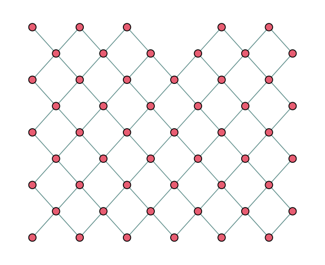
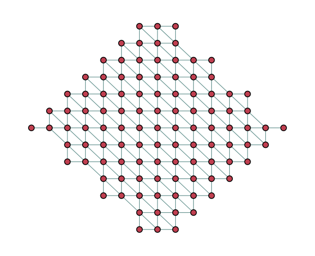
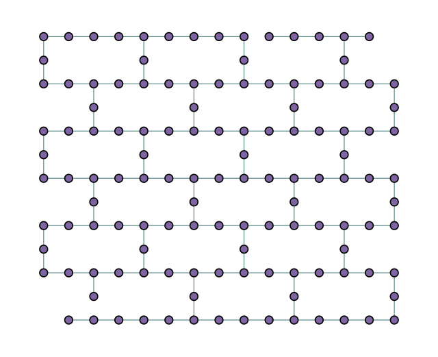
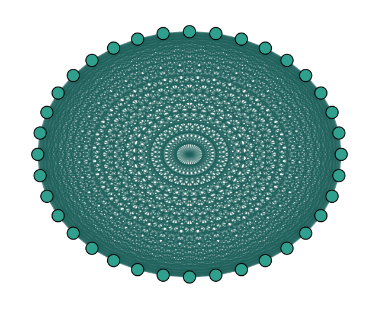
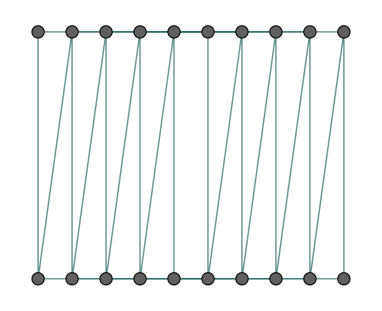
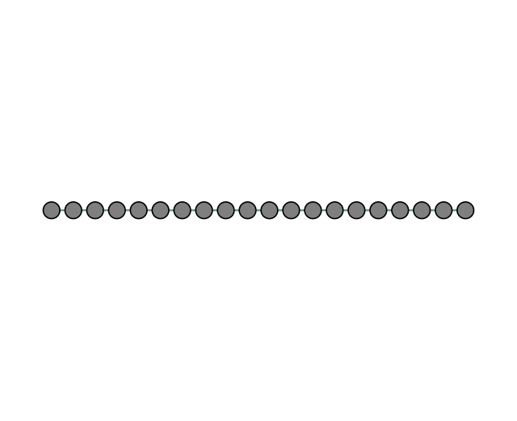
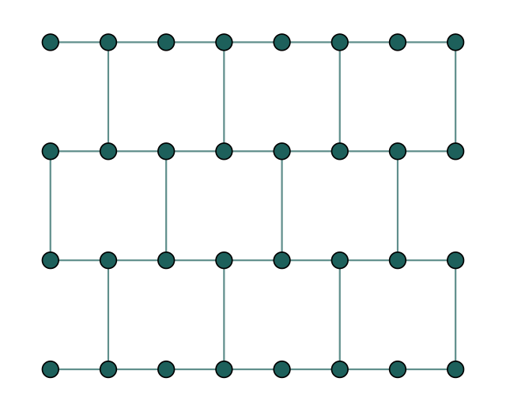
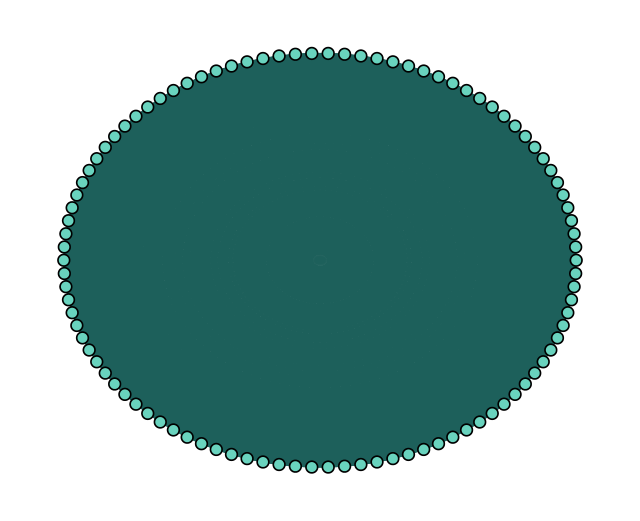
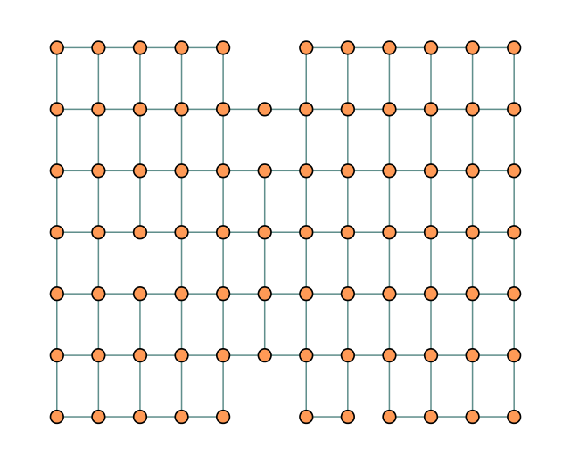
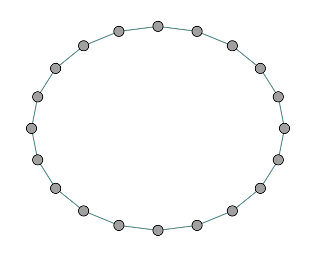

# Connectivity diagrams

Generated by the existing topology script. All ten panels match the paper at 72 dpi. Filenames use public device identifiers; plot labels use the paper labels.

[Run instructions](../../../REPRODUCING.md#percolation-and-topology-panels). PNGs below are previews of the downloadable PDFs.

## google sycamore

[Download PDF](google_sycamore.pdf)

## google willow

[Download PDF](google_willow.pdf)

## ibm washington

[Download PDF](ibm_washington.pdf)

## ionq forte

[Download PDF](ionq_forte.pdf)

## ladder

[Download PDF](ladder.pdf)

## line

[Download PDF](line.pdf)

## oqc toshiko

[Download PDF](oqc_toshiko.pdf)

## quantinuum helios

[Download PDF](quantinuum_helios.pdf)

## rigetti ankaa

[Download PDF](rigetti_ankaa.pdf)

## ring

[Download PDF](ring.pdf)

